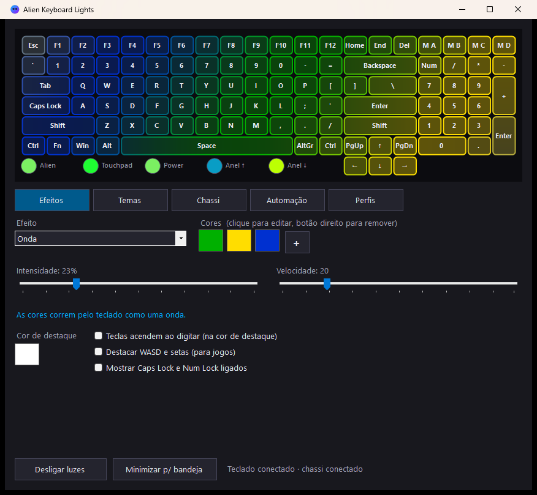

# Alien Keyboard Lights

Lighting control for the **Alienware Area-51m R2** per-key RGB keyboard and chassis lights (alien head, touchpad, power button and Tron ring), without Alienware Command Center.

Controle de iluminação para o teclado RGB por tecla e as luzes do chassi do **Alienware Area-51m R2**, sem precisar do Alienware Command Center. *(Português abaixo.)*

## Features

- Live preview of every key and the chassis lights.
- 20 effects: solid, gradient, smooth fade, breathe, wave, rainbow, blink, twinkle, stripes, radial wave, starfield, scanner (KITT), rain (Matrix), ripple on typing, music visualizer, screen ambient, CPU / RAM / battery meters and per-key painting.
- Overlays on top of any effect: keys light up when typed, WASD + arrows highlight, Caps Lock / Num Lock indicators.
- 25 themes, including holidays (Halloween, Christmas, New Year, Carnival, Easter, Valentine's, Festa Junina, 4th of July, St. Patrick's, Thanksgiving...).
- Chassis lights follow the keyboard, use an accent color, turn off, or stay untouched.
- Automation: turn off after idle time, dim on battery, night schedule, start with Windows (tray).
- Global hotkeys: `Ctrl+Shift+F12` on/off, `F11` next effect, `F8` next theme, `F9`/`F10` brightness down/up.
- Profiles, optionally activated automatically while a given game/app is in the foreground.

## Supported hardware

| Device | USB ID | Protocol |
|---|---|---|
| Per-key RGB keyboard | `0D62:1A1C` | AlienFX API v5 |
| Chassis lights | `187C:0550` | AlienFX API v4 |

Tested on an Area-51m R2. The m17 R3/R4 use the same keyboard controller and may work, but the key layout in the preview is the Area-51m R2 one. Other models are not supported.

## Download and build

No installer and no dependencies: it builds with the C# compiler included in Windows (.NET Framework 4.x).

1. Download or clone this repository.
2. Run `build.bat`.
3. Open `bin\AlienKeyboardLights.exe`.

The interface is in Portuguese. Closing the window keeps it running in the system tray (animated effects need the program running). Use **Sair** (Exit) in the tray menu to quit. Settings and profiles are stored in `%APPDATA%\AlienKeyboardLights`.

## Notes

- If Alienware Command Center also controls the lights, they will fight; close AWCC or leave its lighting alone.
- The "keys light up when typed" and "ripple" options use a Windows low-level keyboard hook only to know which light to flash. Nothing is recorded, and the hook is installed only while one of those options is enabled.
- The Fn key and the macro lights do not react to typing because they do not send key codes to Windows.
- Use at your own risk. This tool talks directly to the lighting controllers.

---

## Português

Programa para controlar as luzes do teclado RGB (tecla por tecla) e do chassi do **Alienware Area-51m R2**.

**Recursos:** prévia ao vivo, 20 efeitos (onda, arco-íris, pisca-pisca, Matrix, KITT, visualizador de música, cores da tela, medidores de CPU/RAM/bateria, pintura por tecla e mais), 25 temas incluindo datas comemorativas, luzes do chassi, desligamento por inatividade, modo noturno, redução na bateria, atalhos globais e perfis automáticos por jogo.

**Como usar:** baixe o projeto, rode `build.bat` e abra `bin\AlienKeyboardLights.exe`. Não precisa instalar nada. Fechar a janela deixa o programa na bandeja; para sair, use **Sair** no menu da bandeja.

Se o Alienware Command Center também mexer nas luzes, os dois brigam: feche o AWCC ou deixe a iluminação dele de lado.

## Credits

The AlienFX USB protocol details come from [alienfx-tools](https://github.com/T-Troll/alienfx-tools) by T-Troll (MIT License). This project is an independent implementation and is not affiliated with Dell or Alienware.

## License

[MIT](LICENSE)
